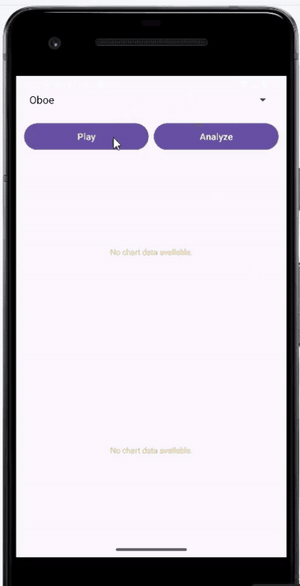
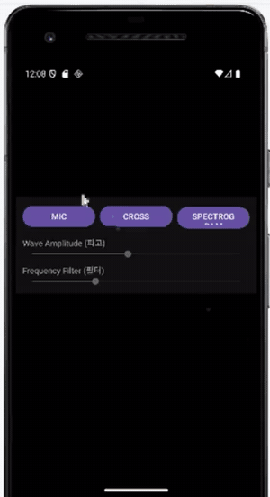
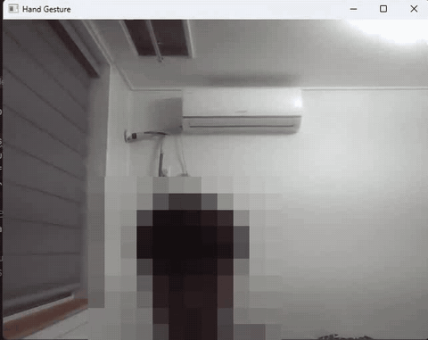

# 개인 프로젝트

신호 처리와 컴퓨터 비전을 직접 구현해 본 개인 프로젝트 모음입니다. 각 폴더에 코드, 시연 움짤, 자세한 README가 있습니다.

| 프로젝트 | 설명 | 기술 |
|---|---|---|
| [푸리에 변환 실습과 소리 합성](fft-sound-synthesis/) | 푸리에 변환을 기호 · 수치 · DFT로 비교하고, 사인파를 더해 에밀레종 맥놀이와 오보에 소리를 합성해 스펙트럼 분석 | Python, NumPy, SciPy, SymPy |
| [악기 소리 파형 · 스펙트럼 분석 앱](instrument-sound-analyzer/) | 오보에 · 클라리넷 · 피아노 · 기타 소리를 재생하고 0~200 ms 파형과 0~4,000 Hz FFT 스펙트럼을 그래프로 비교 | Android(Java), MediaCodec, JTransforms, MPAndroidChart |
| [실시간 3D 스펙트로그램 워터폴](realtime-spectrogram-waterfall/) | 소리를 재생하면서 STFT로 분석하고, 시간에 따라 쌓이는 스펙트럼을 터치로 회전되는 3D 워터폴로 표시 | Android(Java), AudioTrack, STFT, OpenGL ES 2.0 |
| [웹캠 손동작 인식](hand-gesture-recognition/) | MediaPipe 손 관절 21개로 손가락 상태를 판단해 주먹 · 가리키기 · 보자기 · 브이 · 대기 인식 | Python, OpenCV, MediaPipe |

<table>
  <tr>
    <td align="center"> 악기 소리 분석</td>
    <td align="center"> 3D 워터폴</td>
    <td align="center"> 손동작 인식 (얼굴 모자이크)</td>
  </tr>
</table>

푸리에 변환 실습(Python)에서 정한 스펙트럼 분석 방법을 악기 소리 분석 앱(Android)으로 옮기고, 이를 시간축까지 확장해 실시간 3D 워터폴(STFT)을 만들었습니다.

## 관련 저장소

- [SORI — AI 한국 수어 학습 플랫폼](https://github.com/GraduationProject-AIHandSign/AIHandSign) — 손동작 인식에서 써 본 MediaPipe 키포인트를 확장해 만든 졸업작품
