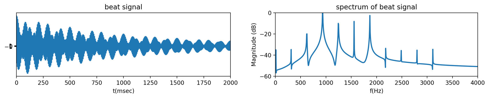

# 푸리에 변환 실습과 소리 합성 (Python)

푸리에 변환을 기호 계산 · 수치 계산 · DFT 근사로 직접 확인하고, 사인파를 더해 **에밀레종 맥놀이**와 **오보에 소리**를 합성한 뒤 스펙트럼을 분석한 노트북 모음입니다.
여기서 정한 스펙트럼 표시 방법(FFT 2,048점, 0~4,000 Hz, dB, 바닥 −60 dB)은 이후 [악기 소리 분석 앱](../instrument-sound-analyzer/)에 그대로 옮겼습니다.

왼쪽: 에밀레종 맥놀이 파형 · 오른쪽: 합성한 오보에 소리의 스펙트럼 (dB)

## 노트북 구성

| 파일 | 내용 |
|---|---|
| `FFT.ipynb` | **푸리에 변환 기초** — sympy로 사각 펄스 · 지수 신호의 푸리에 변환 계산, Simpson 수치적분으로 구한 결과와 해석해 비교, DFT(FFT)로 연속 푸리에 변환 근사, `scipy.signal.freqs`로 주파수 응답(크기 · 위상, 로그 스케일), `residue` 부분분수 전개로 임펄스 응답 계산 |
| `에밀레종.ipynb` | **맥놀이(beat) 합성** — 주파수가 조금 다른 감쇠 코사인(168 ± 5 Hz, 322 Hz)을 더해 종소리의 맥놀이 재현, 스펙트럼 확인, Δf(1 · 2 · 5 · 10 Hz)와 감쇠 계수를 바꿔 가며 파형 변화 비교 |
| `오보에.ipynb` | **오보에 소리 합성** — 약 311 Hz 기본음과 배음(622 · 934 · 1,246 · … · 3,111 Hz)을 세기를 달리해 더한 뒤, FFT 2,048점 스펙트럼을 dB로 변환해 0~4,000 Hz 구간 표시 |
| `mp3 converter.ipynb` | 합성한 오보에 신호(11,025 Hz, 3초)의 파형을 보고 소리로 재생 |
| `oboe.wav` | 위에서 만든 합성 오보에 소리 |

## 기술 스택

Python, NumPy, SciPy (`fft`, `integrate`, `signal`), SymPy, Matplotlib

## 배운 점

- 해석해 · 수치적분 · DFT 근사가 같은 스펙트럼을 주는지 비교하며, 샘플링 간격과 신호 구간이 DFT 근사 정확도에 주는 영향을 확인
- 두 주파수의 차이(Δf)가 맥놀이 주기를 결정한다는 점
- 악기의 음색은 기본음과 배음의 세기 비율로 결정되고, 이를 dB 스펙트럼으로 보면 차이가 잘 드러난다는 점
