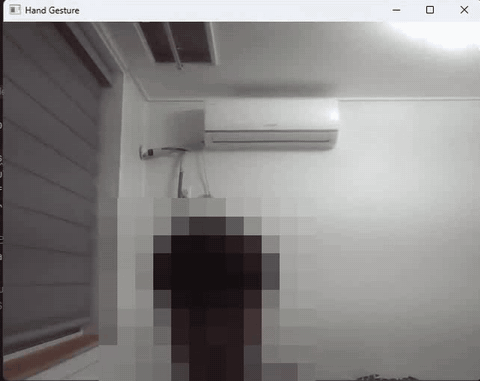

# 웹캠 손동작 인식 (OpenCV · MediaPipe)

웹캠 영상에서 MediaPipe Hands로 손 관절 21개를 찾고, 손가락이 펴졌는지 접혔는지 규칙으로 판단해 **주먹 · 가리키기 · 보자기 · 브이 · 대기** 다섯 가지 손동작을 인식하는 Python 프로그램입니다.

<p align="center"></p>

## 인식 방법

1. 웹캠 프레임을 좌우 반전한 뒤 RGB로 바꿔 MediaPipe Hands에 넣습니다. (손 1개, 검출 · 추적 신뢰도 0.5)
2. 손가락 5개의 상태를 `[엄지, 검지, 중지, 약지, 소지]` 형태의 0/1 리스트로 만듭니다.
   - **엄지**: 끝(4번)의 x좌표가 3번 관절보다 작으면 펴짐
   - **나머지 네 손가락**: 끝(8·12·16·20번)의 y좌표가 PIP 관절(6·10·14·18번)보다 위에 있으면 펴짐
3. 상태 리스트를 손동작으로 바꿉니다.

| 손가락 상태 | 손동작 |
|---|---|
| `[0, 0, 0, 0, 0]` | fist (주먹) |
| `[0, 1, 0, 0, 0]` | point (가리키기) |
| `[1, 1, 1, 1, 1]` | open (보자기) |
| `[0, 1, 1, 0, 0]` | peace (브이) |
| `[1, 1, 0, 0, 0]` | standby (대기) |

인식 결과는 콘솔에 출력하고, 화면에는 손 관절과 연결선을 그립니다. `ESC`를 누르면 종료합니다.

## 실행 방법

```bash
pip install -r requirements.txt
python hand_gesture.py
```

`mp.solutions` API를 쓰기 때문에 이 API가 포함된 MediaPipe 버전(예: 0.10.14)이 필요합니다.

## 한계

- 엄지 판정이 x좌표 비교라서, 좌우 반전된 화면 기준 **오른손**일 때만 맞게 동작합니다.
- 손가락 끝과 관절의 y좌표만 비교하므로, 손을 옆으로 눕히거나 기울이면 판정이 틀릴 수 있습니다.
- 표에 없는 조합은 `None`으로 출력됩니다.

## 이후 발전

이 프로젝트에서 써 본 MediaPipe 손 키포인트 추출을 바탕으로, 이후 졸업작품에서 손 · 얼굴 · 포즈 키포인트 274차원을 Transformer로 학습해 한국 수어 단어 3,000개를 인식하는 학습 플랫폼을 만들었습니다.
→ [SORI — AI 한국 수어 학습 플랫폼](https://github.com/GraduationProject-AIHandSign/AIHandSign)
