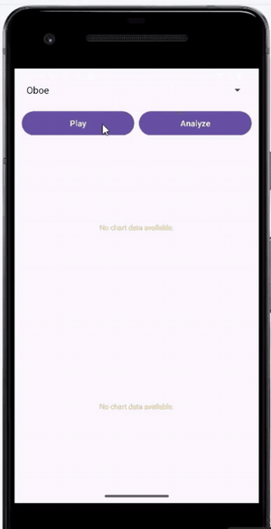

# 악기 소리 파형 · 스펙트럼 분석 앱 (Android)

오보에 · 클라리넷 · 피아노 · 기타 소리를 재생하고, 소리의 **시간 파형**과 **주파수 스펙트럼(FFT)** 을 그래프로 보여주는 안드로이드 앱입니다.
Python으로 먼저 해 본 소리 분석([fft-sound-synthesis](../fft-sound-synthesis/))을 안드로이드에서 직접 계산하도록 옮겼습니다.

<p align="center"></p>

## 기능

- **악기 선택**: Spinner에서 Oboe / Clarinet / Piano / Guitar 선택
- **Play**: 선택한 악기 소리 재생 (MediaPlayer)
- **Analyze**: MP3를 디코딩해 두 개의 그래프 표시
  - 위: 처음 **0~200 ms 구간의 파형** (가로축 ms)
  - 아래: **0~4,000 Hz 주파수 스펙트럼** (dB, 최댓값 기준 0 dB, 바닥 −60 dB)

악기마다 배음(하모닉스) 봉우리가 나타나는 위치와 세기가 달라, 같은 음이라도 음색이 다른 이유를 그래프로 비교할 수 있습니다.

## 처리 흐름

```
res/raw/*.mp3 ─▶ MediaExtractor + MediaCodec (MP3 → 16-bit PCM, 스테레오 가정 후 왼쪽 채널만 사용)
             ─▶ 0~200 ms 샘플 → 파형 그래프
             ─▶ 앞 2,048 샘플 (부족하면 0 채움) → JTransforms FFT
             ─▶ |X(k)| → dB 변환, k·fs/2048 Hz 중 4,000 Hz 이하만 → 스펙트럼 그래프
```

분석은 백그라운드 스레드에서 실행하고, 결과만 UI 스레드에서 MPAndroidChart로 그립니다.

## 기술 스택

| 분류 | 사용 기술 |
|---|---|
| 언어 · 플랫폼 | Java, Android (minSdk 24, targetSdk 36) |
| 오디오 디코딩 | MediaExtractor, MediaCodec |
| FFT | [JTransforms 3.1](https://github.com/wendykierp/JTransforms) (`DoubleFFT_1D`) |
| 그래프 | [MPAndroidChart v3.1.0](https://github.com/PhilJay/MPAndroidChart) (LineChart) |

## 파일 구성

```
app/
├── build.gradle.kts                     의존성 (MPAndroidChart, JTransforms)
└── src/main/
    ├── java/com/cookandroid/afinal/
    │   ├── MainActivity.java            UI, 재생, 그래프 그리기
    │   └── AudioAnalyzer.java           MP3 디코딩, 파형 추출, FFT, dB 변환
    └── res/
        ├── layout/activity_main.xml     Spinner + 버튼 2개 + 차트 2개
        └── raw/                         clarinet · guitar · oboe · piano.mp3
settings.gradle.kts                      jitpack 저장소 추가 (MPAndroidChart용)
```

## 실행 방법

이 폴더에는 직접 작성한 핵심 파일만 들어 있습니다 (AndroidManifest, gradle wrapper, 버전 카탈로그 등 Android Studio 기본 생성 파일은 제외).

1. Android Studio에서 **Empty Views Activity(Java)** 프로젝트를 만듭니다. 패키지명은 `com.cookandroid.afinal`
2. 위 파일들을 같은 경로에 덮어씁니다.
3. Gradle Sync 후 에뮬레이터나 기기에서 실행합니다.

## 한계

- 디코딩 결과를 항상 스테레오로 가정하고 왼쪽 채널만 꺼냅니다. 포함된 파일 중 **clarinet·oboe.mp3는 모노**(guitar·piano는 스테레오)라서, 이 두 악기는 샘플을 하나씩 건너뛰게 되어 파형 시간축은 2배 압축되고 스펙트럼 주파수는 2배로 표시됩니다. 디코더 출력 포맷의 `KEY_CHANNEL_COUNT`를 읽어 채널 수에 맞게 처리하면 고칠 수 있습니다.
- FFT에 창 함수(Hann 등)를 적용하지 않아 스펙트럼에 누설(leakage)이 섞여 있습니다.

## 배운 점

- 압축 오디오(MP3)를 그대로 분석할 수 없어, MediaCodec으로 PCM 샘플을 직접 꺼내야 한다는 점
- FFT 크기(2,048)와 샘플링 주파수로 주파수 해상도(fs/N ≈ 21.5 Hz @ 44.1 kHz)가 정해진다는 점
- 긴 연산은 백그라운드 스레드에서 처리해야 UI가 멈추지 않는다는 점
