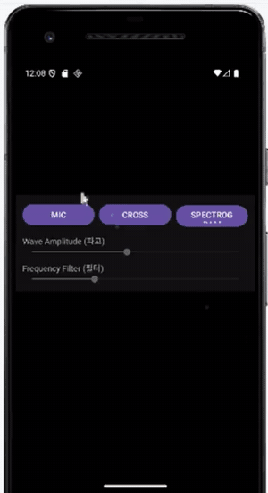

# 실시간 3D 스펙트로그램 워터폴 (Android · OpenGL ES)

소리를 재생하면서 동시에 **STFT(단시간 푸리에 변환)** 로 주파수를 분석하고, 시간에 따라 쌓이는 스펙트럼을 **OpenGL ES 2.0 3D 워터폴**로 그리는 안드로이드 앱입니다. 화면을 드래그하면 그래프를 회전해 볼 수 있습니다.

<p align="center"></p>

## 기능

- **재생 + 실시간 분석**: 버튼을 누르면 오보에 소리(`res/raw/oboe.mp3`)를 재생하면서, 재생 중인 PCM을 바로 STFT에 넣어 분석
- **3D 워터폴**: 최근 120프레임의 스펙트럼을 리본 형태로 쌓아 표시. 높이 = 세기(dB), 색 = jet 컬러맵
- **터치 회전**: 드래그로 좌우(yaw) · 상하(pitch) 회전, 상하 각도는 뒤집히지 않게 제한
- **Wave Amplitude SeekBar**: 표시 높이 배율 조절 (0.05~2.0배)
- **Frequency Filter SeekBar**: 표시할 최대 주파수 조절 (최소 200 Hz)
- **SPECTROGRAM 버튼**: 워터폴 표시 켜기/끄기

## 처리 흐름

```
oboe.mp3 ─▶ MediaExtractor + MediaCodec (디코딩 스레드)
         ├─▶ AudioTrack 재생
         └─▶ StftAnalyzer: 링 버퍼 ─▶ 2,048 샘플 프레임 × Hann 창 ─▶ JTransforms FFT
                                   ─▶ 512 샘플씩 이동 (hop) ─▶ 20·log10|X| (dB) 열 생성
                                                                  │
SpectrogramRenderer ◀────────────────────────────────────────────┘
  최근 120열 보관 ─▶ 주파수 bin마다 정점 2개(앞/뒤) ─▶ GL_TRIANGLE_STRIP 리본
  ─▶ MVP 행렬 (터치 회전) ─▶ 버텍스 · 프래그먼트 셰이더로 그리기
```

## 기술 스택

| 분류 | 사용 기술 |
|---|---|
| 언어 · 플랫폼 | Java, Android |
| 오디오 | MediaExtractor, MediaCodec, AudioTrack (스트리밍 재생) |
| 신호 처리 | STFT — FFT 2,048 · hop 512 · Hann 창, [JTransforms](https://github.com/wendykierp/JTransforms) `FloatFFT_1D` |
| 그래픽 | OpenGL ES 2.0 (GLSurfaceView, GLSL 셰이더, 깊이 테스트) |

## 파일 구성

```
app/src/main/
├── java/com/cookandroid/waterfall/
│   ├── MainActivity.java             버튼 · SeekBar 연결
│   ├── Mp3DecodePlayer.java          MP3 디코딩 + AudioTrack 재생 + 분석기로 PCM 전달
│   ├── StftAnalyzer.java             링 버퍼, Hann 창, FFT, dB 변환
│   ├── SpectrogramSurfaceView.java   GLSurfaceView, 터치 드래그 → 회전
│   └── SpectrogramRenderer.java      워터폴 메시 생성, jet 컬러맵, 셰이더
└── res/
    ├── layout/activity_main.xml      3D 뷰 + 버튼 3개 + SeekBar 2개
    └── raw/oboe.mp3
```

## 실행 방법

이 폴더에는 직접 작성한 핵심 파일만 들어 있습니다 (AndroidManifest, gradle 파일 등 Android Studio 기본 생성 파일은 제외).

1. Android Studio에서 **Empty Views Activity(Java)** 프로젝트를 만듭니다. 패키지명은 `com.cookandroid.waterfall`
2. 위 파일들을 같은 경로에 덮어씁니다.
3. `app/build.gradle.kts`의 `dependencies`에 JTransforms를 추가합니다.
   ```kotlin
   implementation("com.github.wendykierp:JTransforms:3.1")
   ```
4. Gradle Sync 후 실행합니다.

## 한계와 다음 단계

- 버튼 이름은 **MIC**이지만, 현재는 마이크 대신 `oboe.mp3`를 재생해 분석합니다. `AudioRecord`로 마이크 입력을 받아 같은 `StftAnalyzer.pushPcm16()`에 넣으면 실제 마이크 분석으로 확장할 수 있습니다.
- **CROSS**(단면 보기) 버튼은 토글 상태만 바뀌고 아직 그리기는 구현하지 않았습니다.
- 포함된 `oboe.mp3`는 11,025 Hz 모노라서 표시 가능한 최대 주파수는 약 5.5 kHz입니다.
- 스테레오 입력은 채널을 나누지 않고 그대로 이어서 분석합니다.

## 배운 점

- 재생과 분석을 한 디코딩 스레드에서 처리하면, 들리는 소리와 화면의 스펙트럼을 맞출 수 있다는 점
- STFT에서 창 크기(주파수 해상도)와 hop 크기(시간 해상도) 사이의 균형
- OpenGL ES에서 정점 · 색 버퍼를 매 프레임 다시 만들고, MVP 행렬로 회전을 적용하는 흐름
